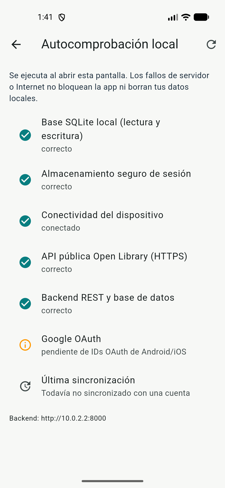
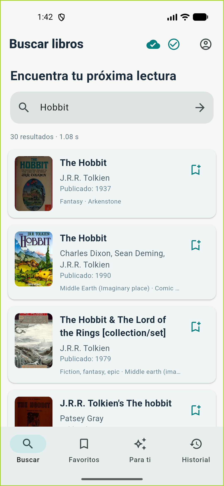
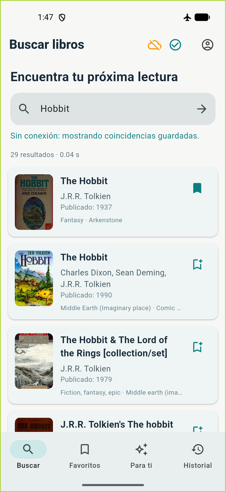
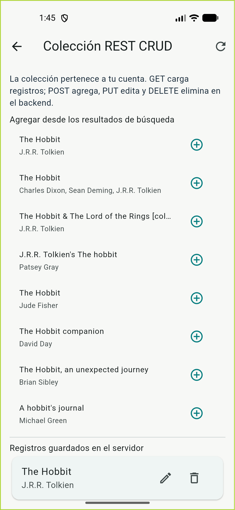
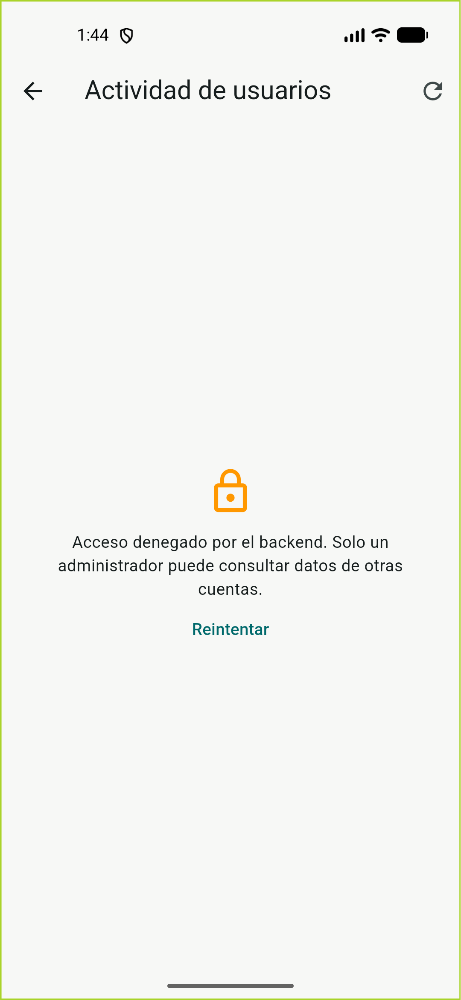
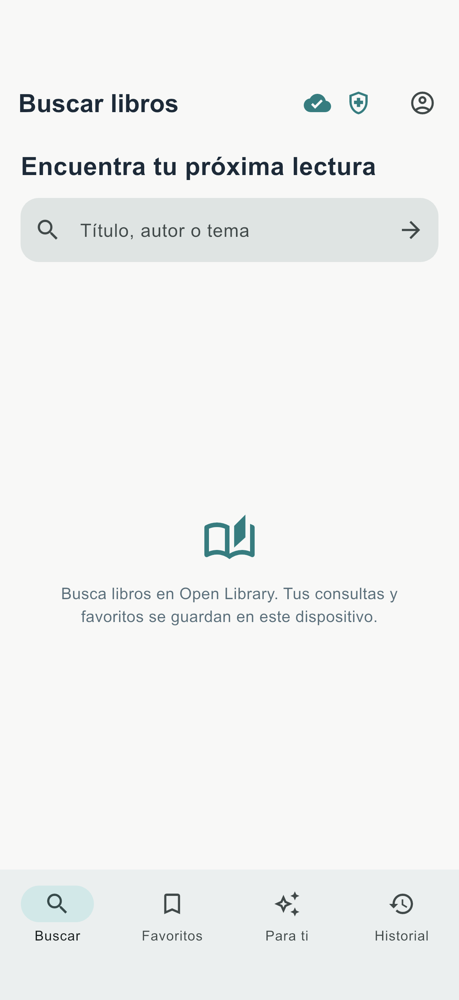
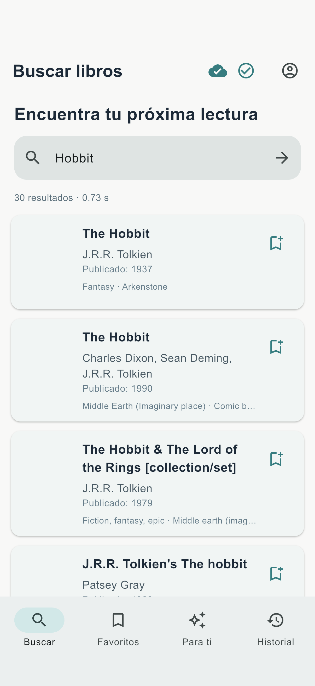
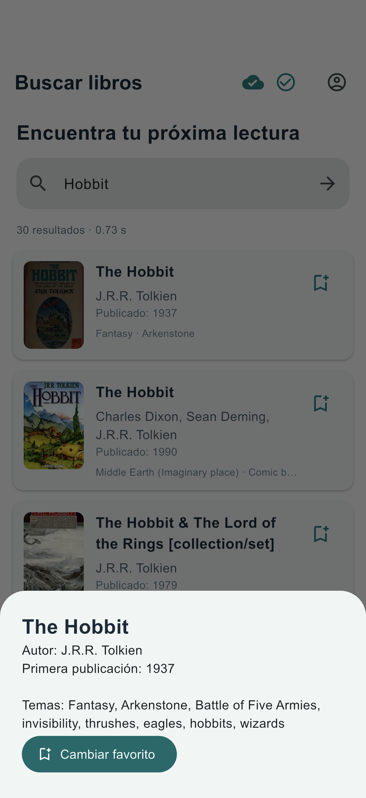
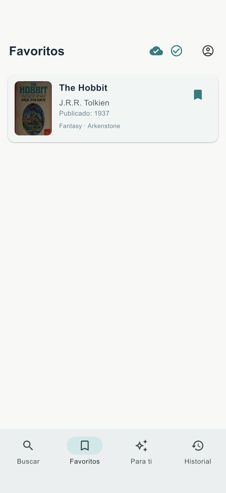
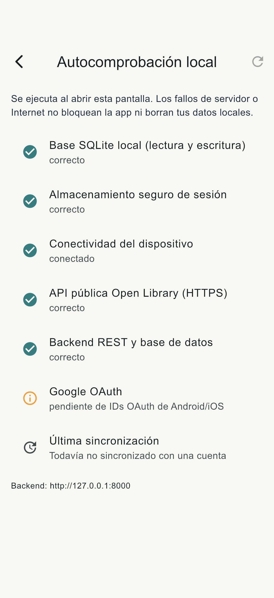

# Práctica 5 — Biblioteca ESCOM

Aplicación Flutter para Android e iOS con Open Library, almacenamiento SQLite offline, cuentas, sincronización, colección REST y permisos de administrador. El proyecto incluye la app y su backend Flask. La búsqueda pública no necesita API key. En desarrollo, backend/app usa HTTP sólo para el emulador local; las consultas públicas y portadas usan HTTPS. Para publicar el backend, usa un dominio HTTPS y compila la app con ese `API_BASE_URL`.

## Clonar y ejecutar en Android

Requisitos: Flutter 3.47+ (Dart 3.13.7+), Android Studio/SDK y Docker Desktop. El emulador disponible para esta práctica debe llamarse `Pixel_4a`.

```sh
git clone https://github.com/LuisRan/p5.git
cd p5
flutter pub get
cp .env.example .env
docker compose up -d --build
flutter emulators --launch Pixel_4a
flutter run
```

El valor de JWT de `.env.example` es sólo para el backend local. Para cualquier despliegue crea un valor nuevo y privado para `JWT_SECRET`. El APK Android requiere API 24 o posterior. En el emulador Pixel 4a la app llega al backend por `10.0.2.2:8000` sin configuración adicional. Si Compose no inicia, abre Docker Desktop, espera a que termine de arrancar y repite el comando.

Al iniciar, la app comprueba automáticamente que SQLite puede escribir y leer y que el almacenamiento seguro puede guardar y borrar una prueba. El icono de diagnóstico abre también las comprobaciones de Open Library por HTTPS, backend/base de datos, conectividad y configuración OAuth. Si falla el servidor, la app continúa en modo local y conserva caché, búsquedas y favoritos.

## iOS

Requisitos: macOS, Xcode completo y simulador iOS 15+. Flutter resolverá los plugins nativos con Swift Package Manager en esta configuración. Si `xcode-select -p` apunta a Command Line Tools y `xcrun` no encuentra el SDK iOS, selecciona Xcode antes de compilar:

```sh
sudo xcode-select --switch /Applications/Xcode.app/Contents/Developer
flutter pub get
open -a Xcode ios/Runner.xcworkspace
flutter run -d <id-del-simulador>
```

El bundle ID por defecto está en `ios/Runner.xcodeproj`. Para probar API local en simulador, el cliente usa `127.0.0.1:8000`. Para iPhone físico configura una URL HTTPS accesible desde el dispositivo. La app comparte la misma implementación Flutter para las dos plataformas.

## Google OAuth

El cliente y el endpoint de backend ya validan el flujo Google, pero OAuth requiere los IDs que genera el proyecto del equipo en Google Cloud. No hay IDs ni secretos reales en este repositorio.

1. Crea el consentimiento OAuth y un cliente **Web**, un cliente **Android** (package `edu.ipn.escom.practica5_multiplataforma` y SHA-1 del certificado de debug) y un cliente **iOS** (bundle ID de Xcode). Configura los tres con el mismo proyecto OAuth.
2. En backend, copia `.env.example` a `.env`, cambia `JWT_SECRET` y asigna `GOOGLE_WEB_CLIENT_ID` al ID del cliente Web.
3. Copia `ios/Flutter/GoogleAuth.xcconfig.example` a `ios/Flutter/GoogleAuth.xcconfig` y completa `GOOGLE_IOS_CLIENT_ID`, `GOOGLE_WEB_CLIENT_ID` y el esquema reverso de iOS. Ese archivo está ignorado por Git.
4. Compila pasando IDs públicos de cliente (no son secretos):

```sh
flutter run --dart-define=GOOGLE_WEB_CLIENT_ID=<cliente-web>.apps.googleusercontent.com --dart-define=GOOGLE_IOS_CLIENT_ID=<cliente-ios>.apps.googleusercontent.com
```

En Android, la librería usa el cliente Web como `serverClientId`; Google valida package y SHA-1 del cliente Android. El servidor verifica la firma, audiencia y correo verificado del ID token y luego emite una sesión JWT propia. El JWT se guarda con Keychain/Android Keystore por `flutter_secure_storage`; no se persiste el token de Google.

## Funciones incluidas

- Búsqueda JSON de Open Library, detalle y estados de carga, vacío, error y uso de caché. La interfaz muestra cantidad de resultados y tiempo de consulta.
- SQLite conserva metadatos de libros con fecha, favoritos, historial y cola de operaciones pendientes. El icono de conectividad y los datos locales siguen disponibles offline.
- Favoritos e historial se separan por correo/cuenta. En invitado se quedan locales. Al recuperar conectividad, la cola local se envía ordenada; el servidor deduplica cada operación por ID. Reintenta tras 15 segundos y duplica el intervalo hasta cinco minutos; también se activa en inicio, reconexión o sincronización manual.
- Conflictos: operaciones locales pendientes se aplican en orden de creación al recuperar red. Luego la app aplica la instantánea del servidor, que manda para datos ya sincronizados. Así un reintento no duplica historial ni favoritos.
- «Para ti» puntúa coincidencias de temas entre búsquedas y favoritos. Se basa en libros y temas guardados localmente para reproducir las sugerencias offline; presenta hasta diez resultados y estado vacío cuando no hay candidatos.
- «Colección REST CRUD» permite agregar desde resultados y leer, editar y eliminar registros del servidor mediante GET/POST/PUT/DELETE. Cada fila pertenece al usuario autenticado.
- «Actividad de usuarios (admin)» solicita historiales y favoritos. La API valida rol en el servidor; una cuenta normal recibe HTTP 403 aunque abra esta pantalla.
- Registro/login por correo para desarrollo/equipo; Google OAuth se activa con los IDs anteriores. La sesión ya validada y la base local sobreviven reinicios. El primer login requiere conexión.

## Resumen del informe técnico

### Introducción y arquitectura

El MVP busca libros en una API pública y conserva favoritos/historial durante cortes de red. Flutter mantiene una sola UI y lógica de negocio para Android/iOS. `lib/main.dart` contiene búsqueda, estado y almacenamiento SQLite; `lib/app_services.dart` agrupa sesión, Google Sign-In y cliente REST. Flask expone la API y SQLite persistente en Docker. Open Library complementa el backend como catálogo.

### Modelo de datos y persistencia

| Entidad | Campos clave | Persistencia |
| --- | --- | --- |
| User | id, email, name, role | SQLite de backend; contraseña con hash y salt, o subject Google |
| Book/cache | Open Library key, title, authors, year, subjects, cover id, updated_at | SQLite local; metadatos de catálogo |
| Favorite | user_id, book_key, updated_at | SQLite local y backend, separado por cuenta |
| History | user_id, query, searched_at | SQLite local y backend, separado por cuenta |
| PendingOp | id, user_id, type, payload, created_at | SQLite local hasta confirmación de sincronización |

La identidad local de favoritos/historial usa el correo autenticado; el servidor resuelve cada solicitud desde el JWT y nunca acepta un `user_id` elegido por el cliente. Al cerrar sesión no se borran datos persistidos, pero la vista cambia a otro perfil. Los metadatos públicos de libros pueden compartirse en la caché local.

### Endpoints y autenticación

El cliente usa Open Library `GET /search.json` sobre HTTPS. El backend usa JWT de 30 días en Secure Storage/Keychain y valida ownership en cada ruta. Google entrega un ID token temporal; Flask verifica firma, audiencia y correo verificado antes de emitir JWT propio. La contraseña local se procesa con PBKDF2-SHA256 y salt aleatorio. El rol admin se cambia sólo con el comando de backend descrito arriba.

### Recomendaciones, sincronización y conflictos

Cada libro candidato recibe una puntuación por sus temas compartidos con libros de historial/favoritos. El catálogo consultado y los favoritos quedan en SQLite para repetir la sugerencia sin Internet. Cambios offline se guardan como operaciones únicas con UUID/ID, usuario y hora. El backend aplica cada ID una sola vez; reintenta al reconectar y en intervalos crecientes. Los cambios locales pendientes se aplican en orden, luego la respuesta del servidor reemplaza el estado ya sincronizado. Así, servidor manda para lo confirmado y la cola local para cambios todavía pendientes.

### Conclusión del MVP

La búsqueda, caché offline, sesión por correo, sincronización, colección CRUD y autorización de administrador se verificaron en Android con backend local. En iOS se compiló y comprobó la búsqueda, el detalle de libro, favoritos y autocomprobación en iPhone 17 Simulator (iOS 27.2). OAuth real aún requiere los IDs del proyecto; el resto de flujos iOS necesita una matriz de comprobación propia.

### Bibliografía (APA)

- Flutter. (s. f.). *Flutter documentation*. https://docs.flutter.dev/
- Flask. (s. f.). *Flask documentation*. https://flask.palletsprojects.com/
- Google Identity. (s. f.). *OpenID Connect*. https://developers.google.com/identity/openid-connect/openid-connect
- Open Library. (s. f.). *APIs*. https://openlibrary.org/developers/api
- Flutter team. (s. f.). *google_sign_in package*. https://pub.dev/packages/google_sign_in
- Flutter community. (s. f.). *flutter_secure_storage package*. https://pub.dev/packages/flutter_secure_storage
- Docker. (s. f.). *Docker Compose documentation*. https://docs.docker.com/compose/

### Contribuciones y uso de IA

El MVP y esta documentación se elaboraron con apoyo de OpenAI Codex a partir de las especificaciones del curso; la comprobación Android/backend se ejecutó en el entorno local descrito. Agrega aquí nombres de integrantes, commits y porcentaje/tarea individual: esta carpeta no tenía una lista del equipo y no invento esos datos.

## Backend, API y administrador

El servicio es Flask + SQLite, empaquetado en Docker Compose. La base persiste en el volumen `practica5_data`; no se versiona un archivo con datos personales. Para revisar:

```sh
curl http://localhost:8000/health
docker compose logs -f api
```

Rutas principales:

| Recurso | Métodos y uso |
| --- | --- |
| `/health` | GET: estado del backend y SQLite |
| `/auth/register`, `/auth/login`, `/auth/google`, `/auth/me` | Registro, sesión local, validación Google y sesión actual |
| `/books`, `/books/<id>` | GET/POST/PUT/DELETE de la colección del usuario autenticado |
| `/favorites`, `/history` | Consulta y cambios por usuario autenticado |
| `/sync` | Aplicación idempotente de cambios locales y descarga de instantánea |
| `/admin/activity` | GET sólo para rol admin; rechaza usuarios normales con 403 |

Para elevar una cuenta a administradora, primero regístrala desde la app y luego ejecuta en el host:

```sh
docker compose exec api flask --app app make-admin <correo-registrado>
```

La elevación se ejecuta en backend; la app no permite asignar el rol. La contraseña se guarda con PBKDF2-SHA256 y salt aleatorio. El backend firma JWT con `JWT_SECRET`. Usa HTTPS con reverse proxy al salir de localhost; no expongas el puerto de desarrollo HTTP a Internet.

### API pública

Open Library: `GET https://openlibrary.org/search.json`. Las cubiertas usan `https://covers.openlibrary.org`. No se requieren claves. Los errores HTTP, JSON malformado, timeout y falta de red se muestran sin cerrar la app; si hay coincidencias locales se ofrecen como respaldo.

## Verificación

La autocomprobación local se ejecuta al arrancar cada instalación/ejecución y se puede repetir desde el icono de diagnóstico. Comprueba SQLite y almacenamiento seguro sin borrar datos del usuario. Las comprobaciones de red/servidor sólo informan su estado: no bloquean la app.

| Verificación realizada en este entorno | Resultado |
| --- | --- |
| `flutter analyze` y compilación `flutter build apk --debug` | Correctos; sin incidencias de análisis y APK generado |
| AVD Pixel 4a (API 37): apertura y autocomprobación | App abierta; SQLite y Android Keystore correctos |
| Búsqueda `Hobbit` online | 30 resultados JSON y tiempo visible de 1.08 s |
| Cuenta por correo, sesión segura, favoritos e historial | Registro e inicio correcto en app; favorito e historial sincronizados a la cuenta |
| Reinicio de la app | Sesión y favorito restaurados desde almacenamiento local |
| Offline con modo avión | Aviso de desconexión y 29 coincidencias desde caché; favorito sigue visible |
| Reconexión y cola de operaciones | Recupera 30 resultados; el historial pendiente aparece en el backend. La idempotencia del mismo ID se verificó repitiendo la petición al endpoint |
| Colección REST desde la app | GET/POST/PUT/DELETE verificados en la interfaz |
| Admin desde cuenta normal | Pantalla recibe HTTP 403 del servidor y muestra acceso denegado |
| Docker Compose | Imagen construida, contenedor healthy y `/health` devuelve `status=ok`, `database=ok`; CRUD y elevación admin verificados |
| Google OAuth real | Aún requiere IDs de OAuth del equipo; el botón queda deshabilitado sin ellos |
| iOS Simulator | Build Debug correcto; búsqueda (30 resultados), detalle, favoritos y autocomprobación visibles en iPhone 17, iOS 27.2 |

Los escenarios se ejecutaron en AVD **Pixel_4a, API 37**. Los resultados reportados abajo son los observados en este equipo; todavía no hay una matriz iOS comparable.

| Escenario | Pasos | Esperado | Resultado observado |
| --- | --- | --- | --- |
| Buscar en API pública | Buscar `Hobbit` con conexión | Lista JSON con duración | 30 libros, 1.08 s |
| Autocomprobación | Abrir icono de diagnóstico | SQLite/almacenamiento local pasan; servicios informan estado | SQLite, Keystore, Open Library y backend correctos |
| Registro y sesión | Crear cuenta desde la app y cerrar/reabrir | Token seguro y cuenta restaurada | Cuenta y sesión restauradas en el AVD |
| Favoritos por cuenta | Guardar un libro y entrar a Favoritos | Favorito local y sincronizado | Visible después de sincronizar; no se mezcló con perfil invitado |
| Consulta offline | Activar modo avión y repetir búsqueda ya guardada | Usar caché sin cerrar la app | Aviso offline y 29 coincidencias guardadas |
| Reconexión | Desactivar modo avión | Reconectar y enviar la cola | Red recuperada; historial enviado al backend |
| CRUD REST | Abrir colección; agregar, editar y eliminar | GET/POST/PUT/DELETE por cuenta | Los cuatro cambios respondieron correctamente desde la app |
| Denegación admin | Abrir actividad como usuario | Backend devuelve 403 | La app mostró acceso denegado |
| Admin autorizado | Elevar cuenta con CLI y solicitar actividad | Backend permite el rol admin | HTTP 200 comprobado en backend; no se capturó esa vista en app |

### Evidencias Android

Las capturas se tomaron en el AVD Pixel 4a API 37. La revisión de OAuth aparece pendiente porque el repo no contiene IDs de cliente.

| Escenario | Captura |
| --- | --- |
| Autocomprobación local y servicios |  |
| Búsqueda y tiempo de respuesta |  |
| Favoritos/cache sin conexión |  |
| CRUD en la app |  |
| Autorización de administrador denegada |  |

En esta Mac `xcode-select -p` aún apunta a Command Line Tools. El build se realizó con el Xcode instalado y el simulador; para usar los comandos Flutter habituales en esta máquina, aplica el cambio indicado en los requisitos de iOS. La captura confirma el arranque; Google OAuth y las demás pantallas iOS requieren comprobaciones adicionales.

### Evidencias iOS

Las capturas corresponden a `edu.ipn.escom.practica5Multiplataforma` ejecutándose en el simulador iPhone 17 con iOS 27.2. OAuth no se probó porque faltan los client IDs reales.

| Escenario | Captura |
| --- | --- |
| Inicio |  |
| Resultados Open Library |  |
| Detalle del libro |  |
| Favoritos |  |
| Autocomprobación |  |

## English

Flutter app for Android and iOS with Open Library search, local SQLite, per-account favorites and history, an offline queue, a Flask REST API and backend-enforced admin access. Clone and start the local API with `docker compose up -d --build`, then run `flutter pub get` and `flutter run`. Google OAuth is implemented but requires the team's Google Cloud client IDs and platform setup described above. Local data remains usable when the server or Internet is unavailable. The Android flows were verified on Pixel 4a API 37. The iOS debug build and search, book detail, favorites and local diagnostics were captured on iPhone 17 Simulator (iOS 27.2); remaining iOS flows and real Google OAuth still need dedicated validation and project credentials.
